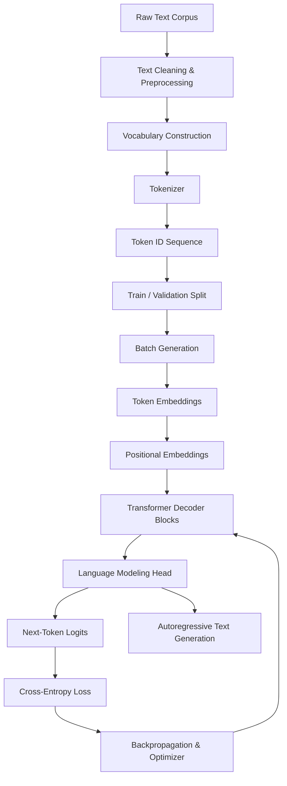

# ADAM-GPT
### Artificially Designed Autonomous Mind

**Building a GPT-style language model from the ground up using PyTorch, tokenization, and a transparent training pipeline.**

ADAM-GPT is an educational and research-oriented project focused on understanding how language models work internally — from raw text processing and tokenization to dataset preparation, neural network architecture, training, and text generation.

The goal is not simply to use a pretrained model or an API, but to progressively implement the core components of a GPT-style model and understand the mathematical and engineering decisions behind them.

> **Project status:** Foundation and data-pipeline stage. Tokenization, dataset preparation, and initial testing are being developed before implementing the Transformer architecture.

---

## Table of Contents

- [Vision](#-vision)
- [Project Objectives](#-project-objectives)
- [System Architecture](#-system-architecture)
- [Current Project Structure](#-project-structure)
- [Implementation Pipeline](#-implementation-pipeline)
- [Technology Stack](#-technology-stack)
- [Getting Started](#-getting-started)
- [Dataset and Preprocessing](#-dataset-and-preprocessing)
- [Testing and Validation](#-testing-and-validation)
- [Development Roadmap](#-development-roadmap)
- [Research Direction](#-research-direction)
- [Author](#-author)

---

## Vision

ADAM-GPT is an attempt to understand the complete lifecycle of an autoregressive language model by implementing its components incrementally.

The project follows a simple principle:

**Understand the mathematics. Implement the mechanism. Validate the behavior. Scale the experiment.**

The initial experiments use the Tiny Shakespeare corpus as a manageable environment for learning language modeling. The architecture and training pipeline can later be extended to larger datasets and more sophisticated model configurations.

## Project Objectives

- Build a tokenizer and a reproducible text-processing pipeline.
- Understand vocabulary construction and token-to-integer mapping.
- Prepare training and validation datasets for next-token prediction.
- Implement token and positional embeddings.
- Build causal self-attention and multi-head attention.
- Assemble Transformer decoder blocks.
- Train a GPT-style model using PyTorch.
- Evaluate training behavior using loss and validation metrics.
- Generate text autoregressively from a learned probability distribution.
- Investigate model behavior through controlled experiments and ablations.

## System Architecture

The intended end-to-end workflow is:



*This diagram represents the target architecture, not a claim that every component is already implemented.*

### How the pipeline works

1. **Corpus preparation:** Load the source text and prepare it for processing.
2. **Tokenization:** Convert text into discrete token IDs using a vocabulary.
3. **Dataset preparation:** Encode the corpus and separate data for training and validation.
4. **Batching:** Create input sequences and shifted targets for next-token prediction.
5. **Transformer model:** Process token and positional representations using causal self-attention and feed-forward layers.
6. **Training:** Minimize next-token prediction loss using backpropagation and an optimizer.
7. **Generation:** Predict one token at a time, append it to the context, and repeat.

## Project Structure

```text
ADAM/
├── src/
│   ├── adam/
│   │   ├── __init__.py
│   │   ├── tokenizer.py
│   │   └── dataset.py
│   │
│   └── data/
│       ├── raw_data/
│       │   └── tinyshakespeare.txt
│       └── processed/
│           ├── metadata.json
│           ├── train.bin
│           ├── val.bin
│           └── vocab.json
│
├── tests/
│   └── test_tokenizer.py
├── main.py
├── pyproject.toml
├── uv.lock
├── .gitignore
└── README.md
```

### Component responsibilities

| Component | Responsibility |
|---|---|
| `tokenizer.py` | Vocabulary and text/token-ID conversion |
| `dataset.py` | Dataset preparation and data-loading utilities |
| `raw_data/` | Original text corpus |
| `processed/` | Encoded training and validation data, vocabulary, and metadata |
| `test_tokenizer.py` | Tokenizer correctness tests |
| `main.py` | Project entry point and orchestration |
| `pyproject.toml` | Dependencies and Python project configuration |
| `uv.lock` | Locked dependency versions for reproducible environments |

The structure will evolve as model, training, evaluation, and generation modules are introduced.

## Implementation Pipeline

### Stage 1 — Data and tokenization

The initial stage establishes a reliable path from raw text to numerical input.

- Load the Tiny Shakespeare corpus.
- Construct a vocabulary.
- Encode text as integer token IDs.
- Decode token IDs back into text.
- Save processed data and vocabulary metadata.
- Test basic tokenizer invariants.

### Stage 2 — Dataset and batching

The next stage prepares examples for causal language modeling.

Given a sequence of token IDs:

```text
Input:  [12, 45, 78, 23]
Target: [45, 78, 23, 91]
```

Each target token is shifted one position ahead of its corresponding input. The model learns to predict the next token using only the preceding context.

### Stage 3 — Transformer implementation

The planned model components include:

- Token embeddings
- Positional embeddings
- Causal self-attention
- Multi-head attention
- Feed-forward networks
- Residual connections and layer normalization
- Transformer decoder blocks
- Vocabulary projection head

### Stage 4 — Training and evaluation

The training system will progressively include:

- Mini-batch sampling
- Cross-entropy loss
- Gradient computation and optimizer updates
- Training and validation loss tracking
- Checkpoint saving and loading
- Text-generation evaluation

### Stage 5 — Inference and experimentation

Once training works end to end, the project will explore generation settings, context length, model depth, embedding dimensions, and other architectural choices.

## Technology Stack

| Technology | Purpose |
|---|---|
| Python | Core implementation |
| PyTorch | Tensor operations, neural networks, and training |
| NumPy | Numerical and data-processing utilities |
| uv | Dependency and environment management |
| pytest | Automated testing |
| Git and GitHub | Version control and project tracking |

The model is intended to be implemented directly rather than relying on a pretrained GPT model as its core language-modeling engine.

## Getting Started

### Requirements

- Python 3.14 or a compatible version supported by the selected dependencies
- [uv](https://docs.astral.sh/uv/)
- Git
- Sufficient memory and disk space for the dataset and experiments

A GPU is not required for the initial tokenizer and dataset stages. Training larger models may require GPU acceleration or a cloud notebook.

### 1. Clone the repository

```bash
git clone https://github.com/RajeshPhulwaria006/ADAM.git
cd ADAM
```

### 2. Set up the environment

```bash
uv sync
```

This installs the project dependencies and synchronizes the environment with `uv.lock`.

### 3. Run the tests

```bash
uv run pytest -v
```

### 4. Run the project entry point

```bash
uv run python main.py
```

The entry point's available behavior depends on the current implementation.

## Dataset and Preprocessing

The initial corpus is **Tiny Shakespeare**, a compact text dataset commonly used for character-level language-modeling experiments.

The processed dataset currently includes:

- `train.bin` — encoded training sequence
- `val.bin` — encoded validation sequence
- `vocab.json` — vocabulary mapping
- `metadata.json` — dataset and preprocessing metadata

These files form the bridge between raw text and numerical model inputs.

Before training, the preprocessing pipeline should be checked for consistent vocabulary mappings, valid token IDs, and a non-overlapping train/validation split.

## Testing and Validation

Correctness is established incrementally, before scaling model complexity.

Planned validation checks include:

- Tokenizer encode/decode consistency
- Unknown-token and invalid-input handling
- Dataset dimensions and data types
- Input-target alignment for next-token prediction
- Causal masking that prevents access to future tokens
- Finite training and validation losses
- Successful checkpoint reloads
- Reproducible experiments using controlled random seeds

Model quality should be assessed with held-out loss and carefully designed experiments rather than training loss alone.

## Development Roadmap

- [x] Establish the Python project structure
- [x] Add the initial Tiny Shakespeare corpus
- [x] Create processed dataset and vocabulary artifacts
- [ ] Validate tokenizer tests and package imports
- [ ] Implement and test next-token batch generation
- [ ] Implement token and positional embeddings
- [ ] Implement causal self-attention
- [ ] Build Transformer decoder blocks
- [ ] Implement the language-modeling head
- [ ] Complete the training loop
- [ ] Track training and validation loss
- [ ] Implement checkpointing and text generation
- [ ] Run baseline experiments and document results
- [ ] Explore larger datasets and architecture ablations

*Checklist items should be updated as each milestone is verified.*

## Research Direction

ADAM-GPT is intended to grow beyond a basic implementation into an experimental platform for studying language-model behavior.

Potential research directions include:

- Effects of model depth and context length
- Attention mechanisms and positional representations
- Training stability and gradient behavior
- Parameter count versus model performance
- Dataset quality and generalization
- Sampling strategies and generation quality

Experiments will be documented with configurations, metrics, and reproducible procedures wherever possible.

## Author

**Rajesh Phulwaria**

BCA student interested in AI/ML engineering, deep learning, and language-model research.

- GitHub: [@RajeshPhulwaria006](https://github.com/RajeshPhulwaria006)
- LinkedIn: [Rajesh Phulwaria](https://www.linkedin.com/in/rajesh-phulwaria-b61093315/)
- Portfolio: [rajeshphulwaria-portfolio.netlify.app](https://rajeshphulwaria-portfolio.netlify.app/)

---

*ADAM-GPT — built to understand language models from the inside out.*
